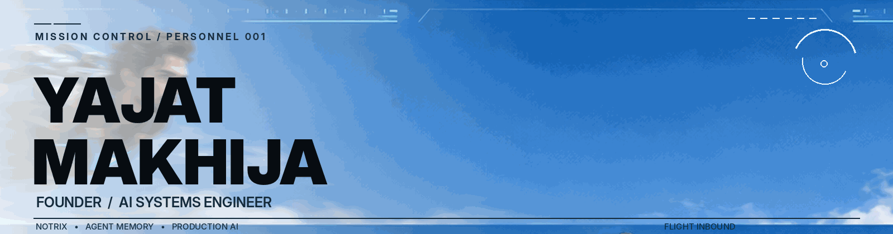
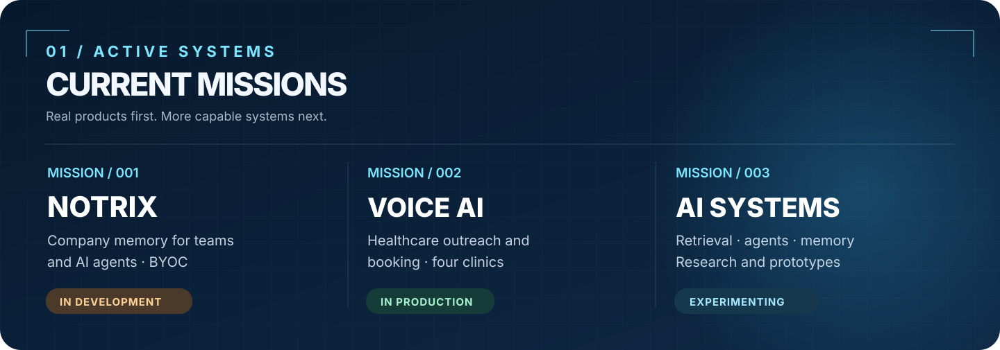
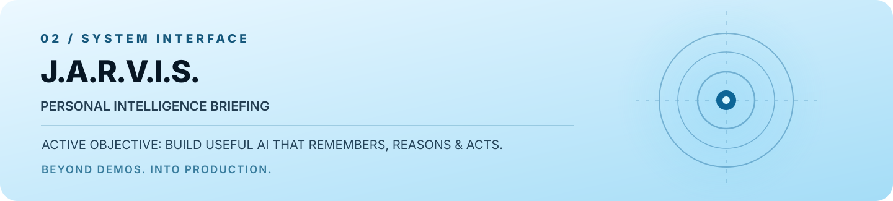

 

<a href="https://yajatmakhija.github.io/YajatMakhija/"><b>ENTER MISSION CONTROL</b></a>
&nbsp;&nbsp; · &nbsp;&nbsp;
<a href="https://github.com/YajatMakhija">GITHUB</a>
&nbsp;&nbsp; · &nbsp;&nbsp;
<a href="https://www.notrix.si">NOTRIX</a>
&nbsp;&nbsp; · &nbsp;&nbsp;
<a href="mailto:yajatmakhija242@gmail.com">CONTACT</a>

  

**Founder · AI systems engineer · Building the future one system at a time.**

 

I'm **Yajat Makhija** — a third-year CSE (AI/ML) student in New Delhi and the solo founder of **Notrix**. I build AI products around memory, retrieval, agent workflows, and robust backend systems.

I like things that feel like science fiction. I care even more about making them useful in the real world.

 

 

### `THE MISSIONS`

**[Notrix](https://www.notrix.si)** — building shared company memory for teams and AI agents, with Slack-first workflows, cited retrieval, and a bring-your-own-cloud architecture. **In development.**

**[Healthcare voice AI](https://github.com/YajatMakhija/patient_outreach_system)** — built a voice AI patient outreach and appointment booking system for a US healthcare provider with four clinics. **In production.**

**Intelligent systems lab** — experimenting with hybrid RAG, code graphs, AI memory architectures, research agents, and world models. **Ongoing work.**

 

 

### `OPERATOR TOOLKIT`

**AI & retrieval** `LangGraph` · `OpenAI SDK` · `hybrid search` · `pgvector` · `Pinecone` · `Neo4j`  
**Engineering** `Python` · `FastAPI` · `TypeScript` · `PostgreSQL` · `Redis` · `Docker` · `AWS`  
**Voice & automation** `Vapi` · `Twilio` · `Deepgram` · `tool integrations`

### `NEXT FLIGHT PLAN`

Building **Notrix** is the priority. I'm also going deeper into **AI systems design, agent memory, LLM security**, and eventually **robotics / physical AI**.

---

*The suit is fictional. The systems are real.*

Original cinematic sci-fi artwork · Optimized for GitHub Markdown · Animation uses a short illustrated four-beat loop rather than a video file

